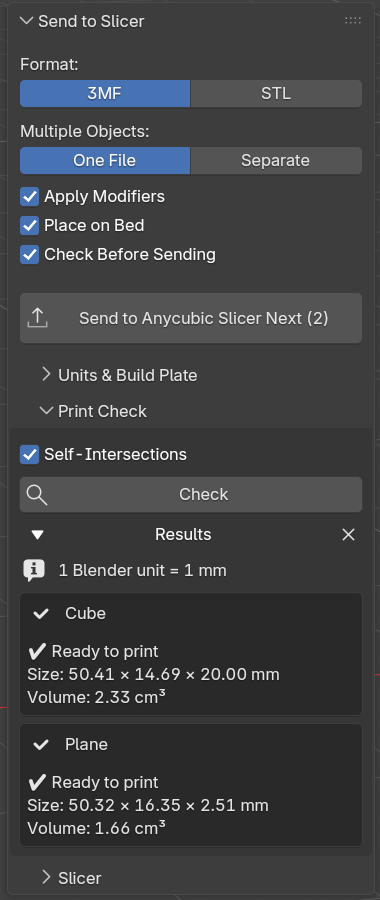

# User Guide

Open the sidebar in the 3D Viewport with **N** and click the **Slicer** tab.

## Sending objects

1. Switch to **Object Mode** and select the objects you want to print. Meshes, curves, text, surfaces and metaballs are supported. Other object types (empties, cameras, lights …) are ignored.
2. Click **Send to *Slicer name* (n)**. *n* is the number of objects that will be exported.

The slicer starts (or comes to the front) with your objects loaded.

### Options

| Option | Default | Description |
|---|---|---|
| **Format** | 3MF | **3MF** stores millimeters as unit and keeps object names; several objects stay separate objects in one file. **STL** is the most compatible format, but has no units or names. |
| **Multiple Objects** | One File | **One File**: all selected objects go into one file. With STL they are merged into one mesh, with 3MF they stay separate objects. **Separate**: one file per object, all opened in the slicer at once. Many slicers then ask whether to treat them as one object with multiple parts, which is useful for multi-color prints. |
| **Apply Modifiers** | On | Exports the result of all modifiers (Mirror, Solidify, Boolean, Subdivision …). Your objects in Blender stay unchanged. |
| **Place on Bed** | On | Moves the selection as a whole so that its lowest point is at Z = 0 and its center is in the middle of the build plate. Distances between the objects are kept. |
| **Check Before Sending** | On | Runs the print check before every send. Problems are reported in the panel and the status bar, but sending is not blocked. |

## Units & Build Plate

*(collapsed by default)*

- **From Scene**: converts using *Scene Properties → Units*. With *Unit Scale* `0.001` and length unit *Millimeters*, 1 Blender unit = 1 mm. With the default scene (*Unit Scale* `1.0`, meters) 1 Blender unit = 1000 mm.
- **Manual**: set your own factor, e.g. `1 BU = 1 mm` if you modeled in "Blender units as millimeters" without changing the unit settings.
- The line *1 Blender unit = … mm* always shows the factor in use.
- **Build Plate (mm)**: size of your printer's build volume, used for *Place on Bed* and the size check. Default: 250 × 250 × 250 mm.
- **Minimum Size**: objects smaller than this (largest side) are reported as probably wrongly scaled.

## Print Check

Click **Check** to analyze all selected objects. Each object gets a result box:

- ✔ **Ready to print**: no problems found
- ⚠ **Warning**: printable in most cases, but worth a look
- ✖ **Error**: very likely to cause a failed or wrong print

The check uses exactly the geometry that would be exported (with modifiers if *Apply Modifiers* is on, in millimeters).

| Message | Level | Meaning / fix |
|---|---|---|
| Not watertight: n open edges (holes) | Error | The mesh has holes. Fill them (*Edit Mode → F*, *Mesh → Clean Up → Fill Holes*) or add a Solidify modifier to flat parts. |
| n edges shared by more than 2 faces | Error | Non-manifold geometry, e.g. internal faces. Delete the extra faces. |
| Normals point inwards | Error | The mesh is inside out. *Edit Mode → Mesh → Normals → Recalculate Outside* (Shift+N). |
| n edges with inconsistent normals | Warning | Some faces are flipped. Same fix: *Recalculate Outside*. |
| Loose geometry | Warning | Vertices or edges without faces. *Mesh → Clean Up → Delete Loose*. |
| n degenerate/duplicate triangles | Warning | Zero-area or doubled faces. *Mesh → Clean Up → Merge by Distance* / *Degenerate Dissolve*. |
| n faces intersect each other | Warning | Parts of the mesh cut through each other. Most slicers handle this, but a Boolean *Union* gives cleaner results. |
| Very small / Huge – wrong units? | Error | The object is under the minimum size or more than 10× larger than the build plate. Check *Units & Build Plate*. |
| Does not fit on the build plate | Warning | Scale the object down or split it. |

Additionally every result shows the **size** in mm and, for closed meshes, the **volume** in cm³.

**Show problems** (magnifier icon next to an object with problems): switches to Edit Mode and selects all open and non-manifold edges so you can see where the holes are. Nothing is changed. Note: with modifiers, the selection shows the base mesh, not the modified result.

The self-intersection check can be turned off (**Self-Intersections**) for very dense meshes; it is skipped automatically above 400,000 triangles.

## Slicer

*(collapsed by default)*: the same settings as in the add-on preferences:

- **Slicer**: *Auto-detect* (first installed slicer from the list), a specific slicer, or *Custom program*.
- **Export Folder**: where the temporary files are written. Empty = `blender_send_to_slicer` in your system's temp folder. Old exports in this folder are deleted on every send.

## Tips

- Want to keep the exact arrangement of your objects? Use **3MF + One File** with *Place on Bed* on. The relative positions stay the same.
- Printing parts in different colors/filaments? Use **Separate** files and let the slicer combine them as one object with multiple parts.
- A shortcut: right-click the **Send to Slicer** button → *Assign Shortcut*.
